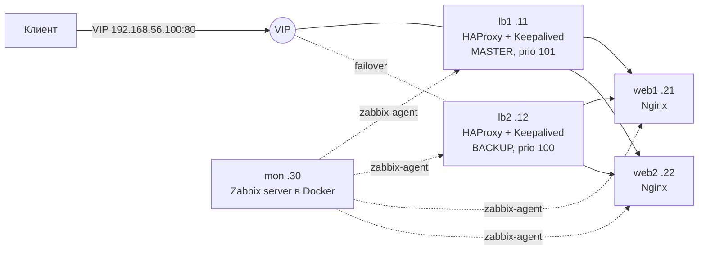

# ha-lb-lab

Учебный стенд отказоустойчивого веб-сервиса: пара балансировщиков **HAProxy + Keepalived** с плавающим VIP, два бэкенда на **Nginx**, развёртывание через **Ansible** и мониторинг в **Zabbix**.

Цель стенда — не просто «поднять по инструкции», а пройти полный цикл эксплуатации: собрать → сломать → найти причину → починить → автоматизировать → поставить на мониторинг. Все сценарии отказов из раздела [«Траблшутинг»](#траблшутинг) воспроизведены и разобраны на этом стенде вручную.

> Это лабораторный стенд на VirtualBox, а не продакшен-конфигурация: без TLS, с упрощённой аутентификацией и одной сетью.

## Архитектура



| Узел | IP | Роль |
|---|---|---|
| lb1 | 192.168.56.11 | HAProxy + Keepalived (MASTER), управляющий узел Ansible |
| lb2 | 192.168.56.12 | HAProxy + Keepalived (BACKUP) |
| web1 | 192.168.56.21 | Nginx, отдаёт свой hostname и `/health` |
| web2 | 192.168.56.22 | Nginx, отдаёт свой hostname и `/health` |
| mon | 192.168.56.30 | Zabbix server, веб-интерфейс и PostgreSQL в Docker Compose |
| VIP | 192.168.56.100 | Плавающий адрес сервиса, его держит текущий мастер VRRP |

**Как это работает.** Клиент обращается только к VIP. Мастер Keepalived держит VIP и раз в секунду рассылает VRRP-объявления. Если мастер умер или на нём упал HAProxy (`track_script`), бэкап забирает VIP и рассылает gratuitous ARP, чтобы соседи обновили ARP-кэш. HAProxy балансирует запросы между web1 и web2 по `roundrobin` и выводит бэкенд из ротации, если тот не прошёл HTTP health-check на `/health`.

## Стек

Debian 13 · VirtualBox · Nginx · HAProxy 3.x · Keepalived (VRRP) · Ansible · Docker Compose · Zabbix 7.0 · PostgreSQL

## Структура репозитория

```
ansible/
  ansible.cfg
  inventory.ini            # хосты и параметры VRRP на каждом lb
  site.yml                 # главный плейбук
  group_vars/all.yml       # VIP, интерфейс, VRID, адрес Zabbix
  roles/
    common/                # hostname, /etc/hosts на всех узлах
    nginx/                 # сайт, страница с hostname, /health
    haproxy/               # frontend/backend, health-check, stats
    keepalived/            # VRRP, VIP, track_script на HAProxy
    zabbix_agent/          # агент + свои UserParameter для балансировщиков
zabbix/
  compose.yml              # Zabbix server + web + PostgreSQL
  .env.example             # пример переменных (реальный .env не коммитится)
  templates/stand_ha_lb.yaml  # шаблон Zabbix: метрики и триггеры для lb
docs/
  zabbix.md                # настройка мониторинга по шагам
```

## Быстрый старт

**Что нужно:** 5 ВМ на Debian 13 в одной Host-only сети `192.168.56.0/24` (адреса — из таблицы выше), пользователь с sudo, вход по SSH-ключу с управляющего узла (lb1) на все узлы по IP.

```bash
cd ansible
ansible all -m ping                   # все узлы отвечают pong
ansible-playbook site.yml -K --check --diff   # сухой прогон
ansible-playbook site.yml -K          # развёртывание
ansible-playbook site.yml -K          # повторный прогон: changed=0
```

Проверка с клиента:
```bash
curl http://192.168.56.100           # ответы чередуются: web1, web2
curl http://192.168.56.11:8404/stats # статистика HAProxy
```

Мониторинг поднимается отдельно на mon, см. [docs/zabbix.md](docs/zabbix.md).

## Ключевые решения

- **`bind *:80` в HAProxy**, а не на VIP: на бэкапе VIP нет, и HAProxy с привязкой к нему не запустился бы. Альтернатива — `net.ipv4.ip_nonlocal_bind=1`.
- **`track_script` на HAProxy**: если HAProxy упал, а узел жив, Keepalived всё равно отдаёт VIP, иначе трафик уходил бы в пустоту.
- **Health-check на `/health`** с `inter 2s fall 3 rise 2`: мёртвый бэкенд выводится из ротации примерно за 6 секунд.
- **`serial: 1` для балансировщиков** в Ansible: lb обновляются по одному, пока один перезагружается, трафик держит второй.
- **`validate` в шаблонах** (`haproxy -c`, `keepalived -t`): конфиг с ошибкой не заменит рабочий.
- **VRID задан в одном месте** (`group_vars`): рассинхронизация номера группы, которая приводит к split-brain, исключена.

## Траблшутинг

Сценарии, воспроизведённые и разобранные на стенде.

| Симптом | Диагностика | Причина | Решение |
|---|---|---|---|
| SSH снова спрашивает пароль вместо ключа | `ssh -v` на клиенте (ключ предложен и отвергнут), `journalctl -u ssh` на сервере | `authorized_keys` с правами 777, sshd (`StrictModes`) ему не доверяет | `chmod 600 ~/.ssh/authorized_keys`, `chmod 700 ~/.ssh` |
| `REMOTE HOST IDENTIFICATION HAS CHANGED` | Сверить отпечаток через консоль: `ssh-keygen -lf /etc/ssh/ssh_host_ed25519_key.pub` | Перегенерированы host-ключи (или IP занят другой машиной) | После сверки — `ssh-keygen -R <ip>` |
| SSH попадает то на одну, то на другую машину | `arp -a`, `arping -D` | Дубликат IP | Вернуть уникальный адрес: `ifdown` → правка → `ifup` |
| У клонов одинаковые machine-id и SSH-ключи | `cat /etc/machine-id` на двух ВМ | Файлы скопировались вместе с диском | `systemd-machine-id-setup`, `dpkg-reconfigure openssh-server` |
| `sudo: unable to resolve host` | `hostname`, `/etc/hosts` | Имя хоста сменено, строка `127.0.1.1` осталась старой | Исправить `127.0.1.1` (теперь делает роль `common`) |
| Nginx отдаёт 403 | `error.log`: `Permission denied`; `ps aux` (worker от `www-data`); `sudo -u www-data cat <файл>` | Файл 600 root:root, worker не может прочитать | `chmod 644` (не 777 и не запуск worker от root) |
| После `reload` изменения не применились, а после `restart` сайт упал | `nginx -t`, `journalctl -u nginx` | Синтаксическая ошибка: reload оставляет старый конфиг, restart останавливает сервис | Всегда `nginx -t && systemctl reload nginx` |
| Nginx не стартует: `Address already in use` | `ss -tlnp \| grep :80` | Порт 80 занят другим процессом | Остановить процесс, занявший порт |
| Бэкенд DOWN в HAProxy, хотя сайт на нём работает | stats HAProxy: `L7STS/500` | `/health` отдаёт 500 — health-check проверяет только то, что в него заложено | Исправить `/health` |
| Каждый второй запрос — ошибка при упавшем бэкенде | stats HAProxy | У сервера убран `check`, HAProxy не знает, что он мёртв | Вернуть `check` |
| HAProxy отдаёт 503 | stats, журнал HAProxy: нет доступных серверов | Упали оба бэкенда | Поднять бэкенды (502 — бэкенд ответил мусором, 504 — не ответил вовремя) |
| VIP на обоих lb (split-brain) | `ip -br a` на обоих, `tcpdump -ni enp0s8 vrrp` | Разный `virtual_router_id` — узлы в разных группах | Единый VRID (вынесен в `group_vars`) |
| VIP на обоих lb при правильных конфигах | `nft list ruleset`; tcpdump видит пакеты **до** файрвола | Файрвол режет VRRP (протокол 112) | Разрешить VRRP; в облаках — `unicast_peer` |
| Ansible: `Host key verification failed` | Ключи хостов в `known_hosts` записаны по именам, а Ansible ходит по IP | Хост адресуется не так, как добавлен в `known_hosts` | Добавить ключи по IP (не `host_key_checking = False`) |
| Ansible не видит inventory | — | Запуск не из корня проекта: `ansible.cfg` ищется в текущем каталоге | Запускать из каталога с `ansible.cfg` |
| Ansible не может подключиться, хотя по SSH всё работает | — | Запуск через `sudo ansible`: используются ключи root | Запускать от пользователя, права — через `become` и `-K` |
| `changed` на каждом прогоне | Вывод плейбука | Задача `command`/`shell` без `changed_when` | `changed_when: false` или `creates` |

## Мониторинг

Агенты ставятся ролью `zabbix_agent`. Кроме стандартного шаблона *Linux by Zabbix agent*, на балансировщиках собираются свои метрики (`UserParameter`):

| Метрика | Что показывает | Триггер |
|---|---|---|
| `stand.haproxy.active` | 1, если HAProxy запущен | HAProxy не запущен на узле |
| `stand.vip.present` | 1, если VIP сейчас на этом узле | Сумма по lb1 и lb2 ≠ 1: split-brain или VIP пропал |

Подробно — в [docs/zabbix.md](docs/zabbix.md).

## Статус

- [x] ВМ, сеть, SSH по ключам
- [x] Nginx-бэкенды с `/health`
- [x] HAProxy: балансировка, health-check, stats
- [x] Keepalived: VIP, failover, сценарии split-brain
- [x] Ansible: роли, идемпотентный прогон (`changed=0`)
- [x] Zabbix: сервер в Docker, агенты через Ansible
- [x] Zabbix: хосты, шаблон `stand_ha_lb`, триггер split-brain, проверка алертов

## Что дальше

- Vagrantfile, чтобы стенд поднимался одной командой
- CI с `ansible-lint` и `yamllint`
- `nopreempt` / `preempt_delay` и сравнение времени переключения
- TLS на HAProxy
- Автоматическая регистрация хостов в Zabbix
